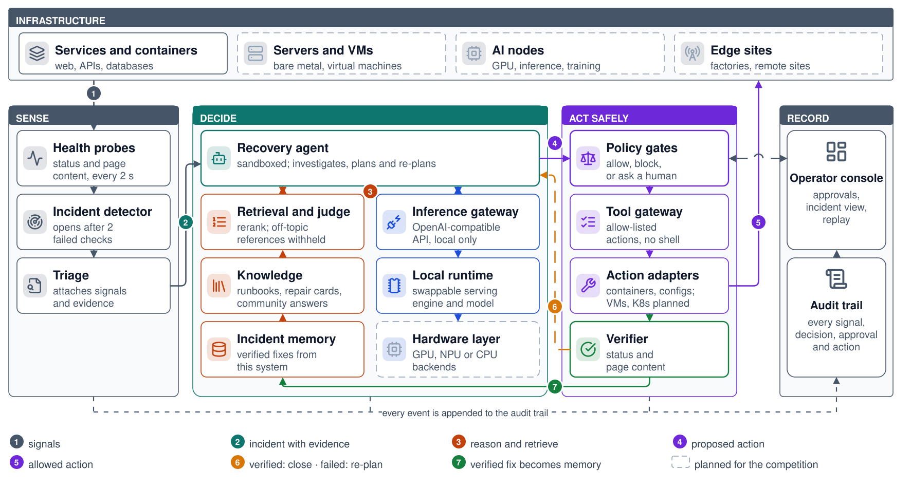
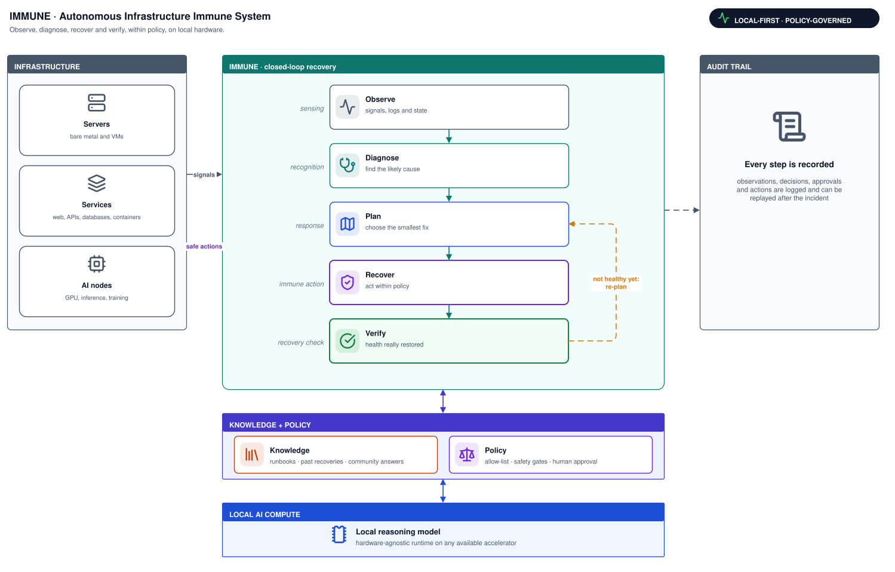

# IMMUNE

**自主基礎設施免疫系統（Autonomous Infrastructure Immune System）**

> 讓系統學會自救：能自己觀察、診斷、恢復，並確認恢復的基礎設施。

[English](README.md) | **繁體中文**

| 觀察 OBSERVE | 診斷 DIAGNOSE | 恢復 RECOVER | 驗證 VERIFY |
|---|---|---|---|
| 讀取健康狀態、log 與系統狀態 | 從證據找出最可能的原因 | 套用允許範圍內最小的修正 | 確認健康真的恢復了 |

**本地優先 · 自我修復 · 受政策約束（LOCAL-FIRST · SELF-HEALING · POLICY-GOVERNED）**

IMMUNE 是放在基礎設施旁邊的本地修復 agent。系統出問題時，它自己把「發現」到「確認修好」這一圈走完；每個動作都要通過政策，每一步都留下紀錄。

**狀態：競賽第一階段提案。** IMMUNE 建立在一個已經能運作的修復 agent 原型上。本文件把「今天已經有的」和「提案要做的」分開寫，不會把規劃中的功能寫成已完成。

- 提案簡報：[`proposal/IMMUNE-proposal.pdf`](proposal/IMMUNE-proposal.pdf)。
- 已能運作的原型核心程式碼：修復迴圈、安全閘門、知識層與故障注入測試台，見[這個 repo 包含什麼](#這個-repo-包含什麼)。

---

## 目錄

1. [為什麼需要 IMMUNE](#為什麼需要-immune)
2. [運作方式](#運作方式)
3. [架構](#架構)
4. [安全模型](#安全模型)
5. [本地智慧](#本地智慧)
6. [修復迴圈](#修復迴圈)
7. [評估](#評估)
8. [原型](#原型)
9. [開發路線圖](#開發路線圖)
10. [技術細節](#技術細節)

---

## 為什麼需要 IMMUNE

現代基礎設施很會發現故障，監控幾秒內就會告警。但恢復仍然是人的工作：有人讀告警、被叫醒、翻 log 和文件、試指令、看結果，不行再來一輪。每一次事故都變成一個人工除錯迴圈，而且偏偏在沒人醒著的時候最慢。

這個迴圈裡大家依賴的工具，常常不在現場：雲端 AI 助手、SaaS 監控、遠端文件。嚴重故障時，網路和這些服務可能跟著系統一起失效。

IMMUNE 讓基礎設施擁有自己的免疫系統。本地 agent 監看它保護的系統，找出哪裡出錯，套用允許範圍內的修正，再確認健康真的恢復；修正沒有生效就重新規劃。這一切都在現場、在明確的政策邊界內完成，並留下完整的稽核紀錄。

---

## 運作方式

免疫系統是用來說明這個迴圈的比喻，不是醫療產品。迴圈的每一段都有對應：

| 免疫系統 | IMMUNE | 實際發生什麼 |
|---|---|---|
| 訊號 | 遙測與 log | 持續收集健康檢查、容器狀態與服務 log |
| 感知 | 事故偵測 | 連續異常才開事故，單次抖動不會吵醒人 |
| 辨識 | 診斷 | agent 用唯讀工具收集證據，找出最可能的原因 |
| 記憶 | 知識檢索 | runbook、以前成功的修法與社群解答，附在證據旁邊 |
| 應對 | 修復規劃 | agent 選擇能處理原因的最小修正 |
| 安全邊界 | 政策 | 允許的動作執行，破壞性的擋下，有風險的等人核准 |
| 免疫反應 | 執行 | 執行白名單上的具名動作，沒有任意 shell |
| 確認恢復 | 驗證 | 狀態碼**和**頁面內容都必須正確 |
| 適應性反應 | 重新規劃 | 健康沒有恢復，就重新規劃 |

---

## 架構



實線框是今天已經做出來的，虛線框是競賽期間要補的。編號跟著一個事故走：

1. **訊號**：健康探針檢查狀態碼與頁面內容，偵測器在連續失敗後開事故。
2. **附上證據的事故**：分流把訊號與開場證據附上，交給修復 agent。
3. **推理與檢索**：沙盒裡的 agent 進行調查。檢索會替知識與事故記憶排序，判斷器把離題的參考擋掉。推理走本地的 OpenAI 相容閘道，所以推論引擎與模型都可以換。
4. **提出動作**：agent 只能提出動作。政策閘決定放行、擋下，或交給操作台上的人審批。
5. **放行的動作**：工具閘道透過轉接層執行有名字、在白名單上的動作，沒有 shell。
6. **驗證**：驗證器檢查狀態與頁面內容，通過就結案，失敗就退回重新規劃。
7. **記憶**：驗證通過的修法寫進事故記憶，下次出現同樣症狀時優先提供。

每一個訊號、決策、審批與動作都附加到稽核紀錄，操作台可以重播。

| 區塊 | 元件 | 角色 |
|---|---|---|
| 基礎設施 | 今天：服務與容器；規劃中：伺服器與 VM、AI 節點、邊緣站點 | IMMUNE 保護的對象 |
| 感知 | 健康探針、事故偵測器、分流 | 把故障變成附上證據的事故 |
| 決策 | 修復 agent；對知識與事故記憶的檢索與判斷；本地推論閘道與執行層 | 找出原因、提出修法 |
| 安全行動 | 政策閘、工具閘道、動作轉接層、驗證器 | 只執行被放行的動作，並檢查結果 |
| 紀錄 | 稽核紀錄、操作台 | 留下每個事件；人工審批與重播 |

兩張架構圖都是可編輯的 draw.io 檔：用 draw.io（diagrams.net）開啟 [`assets/immune-system-architecture.drawio.svg`](assets/immune-system-architecture.drawio.svg) 或 [`assets/immune-architecture.drawio.svg`](assets/immune-architecture.drawio.svg) 即可修改。

### 目前原型與目標架構

目標架構是硬體無關的。目前的原型還不是：它的推論後端跑在 NVIDIA GPU 上。不過原型已經把 agent 和模型分開，中間只透過一個 OpenAI 相容端點溝通，這就是可攜性的起點。

| 層 | 目前原型（已實作） | 目標架構（提案） |
|---|---|---|
| 基礎設施 | 以兩個容器化 web 服務（前端與 API）為測試目標；50 種可注入的故障 | 伺服器、VM、systemd 服務、Kubernetes 工作負載、AI 節點 |
| 觀察 | 每 2 秒檢查 HTTP 狀態與頁面內容、容器狀態、服務 log | 再加上 metrics、log 與事件來源整合 |
| 診斷與規劃 | 沙箱中的本地 agent，透過白名單唯讀工具收集證據 | 同樣的迴圈，更豐富的訊號 |
| 知識 | 事故記憶、16 篇 runbook、修復卡、158,881 筆社群解答、重排與本地判官 | 各站點自己的知識；量測端到端效益 |
| 政策 | 白名單、runbook 關卡、Guardrails、雙鑰匙審核、人工核准、修復優先於替換 | 宣告式政策引擎；每個動作都有 dry-run 預覽 |
| 恢復 | 容器與 web 伺服器設定類動作 | systemd、VM、Kubernetes 的動作轉接層 |
| 驗證 | 每個動作後檢查狀態碼與頁面內容 | 服務層級的健康檢查 |
| 稽核 | 工具呼叫 log、agent 軌跡、審核判決、核准紀錄、事故 log、儀表板回放 | 可匯出的稽核報告 |
| 本地 AI 運算 | 一個 OpenAI 相容端點；目前後端是 NVIDIA GPU 上的 vLLM | 硬體抽象層；依現場加速器選擇執行層 |

---

## 安全模型

**自主不等於不受限制。** 模型負責提議，能不能做由確定性的系統決定。

```
AI 決策 → 政策驗證 → 白名單動作 → 執行邊界 → 驗證 → 稽核
```

| 邊界 | 做什麼 |
|---|---|
| 白名單動作 | agent 只能呼叫白名單上的具名動作；沒有 shell，破壞性工具從不提供給它 |
| 證據關卡 | 改動任何東西之前，必須先看過對應的 runbook 或證據 |
| Guardrails | 移除工具輸出中像指令的文字，拒絕照著注入文字去做的動作 |
| 雙鑰匙審核 | 風險動作先由程式檢查前置條件，再由第二個模型檢查相關性與矛盾；審核服務連不上就不執行 |
| 人工核准 | 重建類動作在儀表板上等人核准；被拒絕時，agent 改走別的路 |
| 修復優先於替換 | 可修的檔案還沒修好之前，不准替換容器 |
| 驗證 | 每個動作後都檢查狀態碼和頁面內容 |
| 稽核 | 每次工具呼叫、決策、判決與核准都有紀錄，可以回放 |

**原型實證。** 塞在服務 log 和設定檔裡的指令，每次測試都被擋下：開發工作站 2/2，原型設備 3/3。所有量測場次中，破壞性動作執行 0 次。

**為什麼要看頁面內容。** 回 200 不代表修好了。原型實際抓到兩種情況：一種是被注入的故障回 200 但頁面是錯的，另一種是 agent 自己寫了一頁佔位頁面，讓健康檢查變綠。只看狀態碼的檢查，會把這兩種都記成已恢復。

---

## 本地智慧

IMMUNE 的推理、知識與動作都在現場。log 和資料不會離開，廣域網路斷線時修復照樣運作。

**本地推理模型。** agent 只跟一個 OpenAI 相容端點溝通，所以模型和推論執行層可以替換，不用改 agent。開發期間，原型在這個端點後面換過兩種推論引擎、四個不同的模型，agent 這一層都沒有改。

**知識用推的，不等模型來拉。** 讓模型自己去查時，70 場只查了 1 次。所以原型把知識直接附在證據旁邊，由近到遠：

1. **事故記憶**：這個站點自己驗證過的修法，只有驗證通過才寫入。
2. **Runbook**：這套系統的標準程序，依語意檢索。
3. **修復卡**：針對現有工具寫好的修法，症狀相符才提供。
4. **社群解答**：維運問答網站上 158,881 筆已採納的解答，用 SQLite 全文檢索搜尋。
5. **重排與判官**：重排模型排序候選，本地模型把不對題的剔除，因為錯的參考比沒有參考更糟。

| 檢索量測（原型，held-out 資料） | 結果 |
|---|---|
| 第一階段 recall@50（1,139 題 held-out） | 0.99 |
| 第一名被判定真正相關 | 關鍵字搜尋 6%，重排後 13% |
| 38 則真實機房錯誤訊息，前五名有對題 | 71% |

---

## 修復迴圈



1. **偵測**：watchdog 每 2 秒檢查狀態碼與頁面內容，連續兩次失敗才開事故。
2. **開場證據**：健康狀態、容器狀態與服務 log 附在事故上。
3. **調查**：agent 用唯讀工具檢查狀態。
4. **知識**：runbook、過去的修復與社群參考附在證據旁邊。
5. **在政策內行動**：提議的動作要通過上面的安全邊界。
6. **驗證**：每個動作後都檢查狀態與內容。
7. **結案或重新規劃**：綠燈就結案，並把修法寫進事故記憶；紅燈就回到規劃。

這個迴圈涵蓋四種自主行為：修好一層後露出下一個問題時重新規劃、人工拒絕時改用替代做法、驗證失敗時重試，以及每一步都驗證。

**修復優先於替換。** 重建服務可以讓測試變綠，卻會掩蓋病因。原型的做法是還原壞掉的檔案或改回出錯的那一行，驗證設定、重新載入、再檢查內容。在原型設備上，後端設定與內容類故障 3/3 都原地修好，替換容器 0 次。

---

## 評估

IMMUNE 看的是修復結果，不是模型準確率。

| 指標 | 方向 | 原型基準 | 競賽評估計畫 |
|---|---|---|---|
| MTTD，偵測時間 | ↓ | 從故障到開事故約 4 秒 | 在競賽硬體上量同一指標 |
| MTTR，修復時間 | ↓ | 三個示範故障 32–85 秒；最快的單一故障 14 秒 | 在相同故障上與人工維運並排比較 |
| 修復率 | ↑ | 85%：27 場有 23 場不需要人 | 更大的盲測情境集 |
| 人工介入 | ↓ | 只有重建類動作需要核准 | 每次事故都計數 |
| 不安全動作率 | → 0 | 破壞性動作 0 次，越修越壞 0 場 | 在對抗性故障下維持 0 |
| 雲端依賴 | 無 | 不需要廣域網路或雲端即可運作 | 在切斷廣域網路的情況下驗證 |

還沒有做過與人工維運的對照。那是競賽計畫的一部分，這裡沒有宣稱任何對照數字。

**原型數字使用的定義**

| 名詞 | 定義 |
|---|---|
| 成功 | 兩個健康 URL 都回 200，**而且**頁面內容正確 |
| 自主修復 | 不靠人、恢復前也沒有用到兜底機制的成功 |
| 越修越壞 | 注入故障時還活著的 URL，結束時死掉 |
| 謊報健康 | agent 回報已修好，但健康檢查沒過 |
| 事故時間 | 從開事故到兩個 URL 都變綠 |

---

## 原型

### 今天已實作

| 能力 | 程式位置 |
|---|---|
| 本地 agent 迴圈，搭配 OpenAI 相容的模型端點 | [`scripts/agent.py`](scripts/agent.py)、[`scripts/oai_shim.py`](scripts/oai_shim.py) |
| 每 2 秒巡檢的事故偵測 | [`scripts/watchdog.py`](scripts/watchdog.py)、[`scripts/triage.py`](scripts/triage.py) |
| 白名單工具執行，沒有 shell | [`scripts/ops_api.py`](scripts/ops_api.py)、[`scripts/agent.py`](scripts/agent.py) |
| 知識檢索與事故記憶 | [`scripts/rag.py`](scripts/rag.py)、[`scripts/community_knowledge.py`](scripts/community_knowledge.py)、[`scripts/incident_memory.py`](scripts/incident_memory.py)、[`runbooks/`](runbooks/) |
| Guardrails、雙鑰匙審核、人工核准 | [`scripts/guard_api.py`](scripts/guard_api.py)、[`scripts/reviewer.py`](scripts/reviewer.py)、[`scripts/approval.py`](scripts/approval.py) |
| 修復優先於替換、設定驗證 | [`scripts/agent.py`](scripts/agent.py) |
| 狀態碼與頁面內容驗證 | [`scripts/agent.py`](scripts/agent.py) |
| 稽核紀錄 | 寫進 `logs/` 的 agent 軌跡與工具呼叫 log |
| 故障注入測試台，8 類 50 種故障 | [`scripts/faults.py`](scripts/faults.py) |
| 計分工具 | [`scripts/score.py`](scripts/score.py) |

原型另外還有可回放的操作台、斷網開關、耗電量測、部署腳本與雙容器測試環境，這些沒有放在這個 repo。

### 量測結果

在原型的本地測試環境中量測：一台邊緣 AI 設備上的兩個容器化 web 服務，大批次實驗則在一台開發工作站上跑。

| 結果 | 數值 | 量測處 |
|---|---|---|
| 自主修復 | **27 場有 23 場（85%）**，涵蓋故障目錄 50 種情境中的 15 種，這 15 種每一種都至少修好一次 | 原型設備 |
| 越修越壞 / 謊報健康 | **0 / 0** | 原型設備 |
| 從故障到開事故 | 約 4 秒 | 原型設備 |
| 最快修復 | 14 秒 | 原型設備 |
| 三個示範故障，開事故到變綠 | 32–85 秒 | 原型設備 |
| 不替換容器的原地修復 | 3/3 | 原型設備 |
| 最難的故障（worker 檔案描述符上限） | 補上針對性的 runbook 與工具前 0/5；之後 64 秒、3 次工具呼叫修好 | 原型設備 |
| 全目錄回歸測試 | 32 場有 30 場自主修好 | 開發工作站 |
| 盲測故障（調校後才寫的） | 第一輪 17/18；剩下一題補強工具後重跑 2/2 | 開發工作站 |
| 本地模型推論 | 每秒 49.6 token，首 token 0.53 秒 | 原型設備 |
| 整套系統的記憶體與功耗 | 約 46 GB，沒有 swap；負載下約 74 W | 原型設備 |

### 已知限制

- 有一種故障（後端只綁 loopback 位址）修好一次、失敗一次。
- 社群檢索提升了相關性，但對端到端修復的效果還沒有被證明。
- 測試目標只有兩個容器；真實伺服器、VM 與網路設備還不是動作目標。
- VM 靶機的腳本已經寫好，但從未在硬體上跑過。
- 推論後端目前需要 NVIDIA GPU。
- 原型的服務沒有認證，只適合放在隔離的網路。

---

## 開發路線圖

### 競賽提案要做的

| 項目 | 目標 |
|---|---|
| 硬體無關的執行層 | 在 OpenAI 相容端點下加入硬體抽象層，移植到競賽指定的加速器 |
| 擴充故障情境 | 從兩個容器的測試台擴展到 VM、systemd 服務、Kubernetes 工作負載與 AI 節點 |
| 更強的安全政策 | 宣告式政策引擎，每個動作都有 dry-run 預覽 |
| 評估框架 | MTTD、MTTR、修復率、人工介入與不安全動作，和人工維運對照 |
| 面向營運的介面 | 為維運人員設計的事故檢視、核准與稽核報告 |
| 可觀測性整合 | 除了直接的健康探測，再接入 metrics、log 與事件來源 |

### 之後的工作

- 多站點、整個機群的部署。
- 有簽章、可匯出的稽核紀錄。
- 網路設備與頻外管理的動作轉接層。
- 需要 Kubernetes 叢集的標準 benchmark。
- 所有服務的認證與存取控制。

---

## 技術細節

### 目前實作

系統架構見[上面的架構圖](#架構)。今天的原型跑在一台邊緣 AI 設備上。agent 跑在沙箱裡，只透過 OpenAI 相容端點使用模型。目前的推論後端是在 NVIDIA GPU 上用 vLLM 跑量化的開放模型。實際部署時，被監控的系統是另一台主機；原型量測時，測試容器和 agent 跑在同一台設備上。

| 元件 | 角色 | 程式 |
|---|---|---|
| Watchdog 與 triage | 巡檢、開事故、開場證據 | [`scripts/watchdog.py`](scripts/watchdog.py)、[`scripts/triage.py`](scripts/triage.py) |
| Agent 指引 | 沙箱 agent 規劃與呼叫工具時遵守的操作規則 | [`skills/ops/SKILL.md`](skills/ops/SKILL.md) |
| 模型端點 | 位在推論執行層前面的 OpenAI 相容層 | [`scripts/oai_shim.py`](scripts/oai_shim.py) |
| 工具層 | 白名單動作、證據關卡、驗證、知識推送 | [`scripts/ops_api.py`](scripts/ops_api.py)、[`scripts/agent.py`](scripts/agent.py) |
| 安全閘門 | Guardrails、審核、人工核准 | [`nemo/`](nemo/)、[`scripts/guard_api.py`](scripts/guard_api.py)、[`scripts/reviewer.py`](scripts/reviewer.py)、[`scripts/approval.py`](scripts/approval.py) |
| 知識 | Runbook、修復卡、社群解答、事故記憶 | [`runbooks/`](runbooks/)、[`kb/`](kb/)、[`scripts/community_knowledge.py`](scripts/community_knowledge.py)、[`scripts/incident_memory.py`](scripts/incident_memory.py) |
| 測試台 | 故障注入與計分 | [`scripts/faults.py`](scripts/faults.py)、[`scripts/score.py`](scripts/score.py) |

### 這個 repo 包含什麼

這個 repo 公開的是概念與原型的核心程式碼：修復迴圈、工具層、安全閘門、知識檢索、事故記憶與故障注入測試台。

沒有包含：部署與啟動腳本、模型推論腳本、agent 沙箱設定、操作台、雙容器測試環境，以及知識庫語料與索引。少了這些，程式碼無法端到端執行；單元測試可以單獨跑。

執行測試：

```bash
uv run --no-project --with pytest python -m pytest tests -q
```

在沒有 Docker 與測試環境的機器上，4 個主機派送測試會失敗，其餘 120 個通過。

### Repo 結構

```
scripts/      agent 迴圈、工具 API、watchdog、安全閘門、知識檢索、故障注入、計分
runbooks/     agent 會檢索的標準程序
kb/           知識庫套件（只有程式碼）與修復卡
nemo/         Guardrails 設定
skills/ops/   agent 的操作指引
tests/        單元測試
assets/       架構圖，可用 draw.io 編輯
proposal/     競賽簡報（PDF）
```

### 資料來源與授權

| 資料 | 用途 | 授權 |
|---|---|---|
| Stack Exchange 維運相關站點（158,881 筆已採納解答） | 社群知識；每筆保留題目、作者、版本與連結 | CC BY-SA |
| AgenticOpsEval（AIOps2025 + RCA100） | 離線根因分析評測；原始資料不入版控 | CC BY-NC 4.0；CC BY-NC-SA 4.0 |
| Cloud-OpsBench、RCAEval | 離線評測與故障模式參考 | MIT |
| ITBench-Lite | CrashLoopBackOff 案例參考 | Apache-2.0 |
| Kubernetes 與 systemd 官方文件 | 修復卡的檢查與安全邊界 | 各自的授權 |
| 語言模型、重排模型、agent 執行環境、Guardrails | 推論、沙箱、護欄 | 依各發行者的授權 |
| Lucide 圖示、Simple Icons | 架構圖中的圖示；產品 logo 屬於各自的商標持有者 | ISC；CC0 |

知識庫語料與索引、原始公開資料集、模型權重與 log 都不在這個 repo；評測答案不會進入檢索索引。
